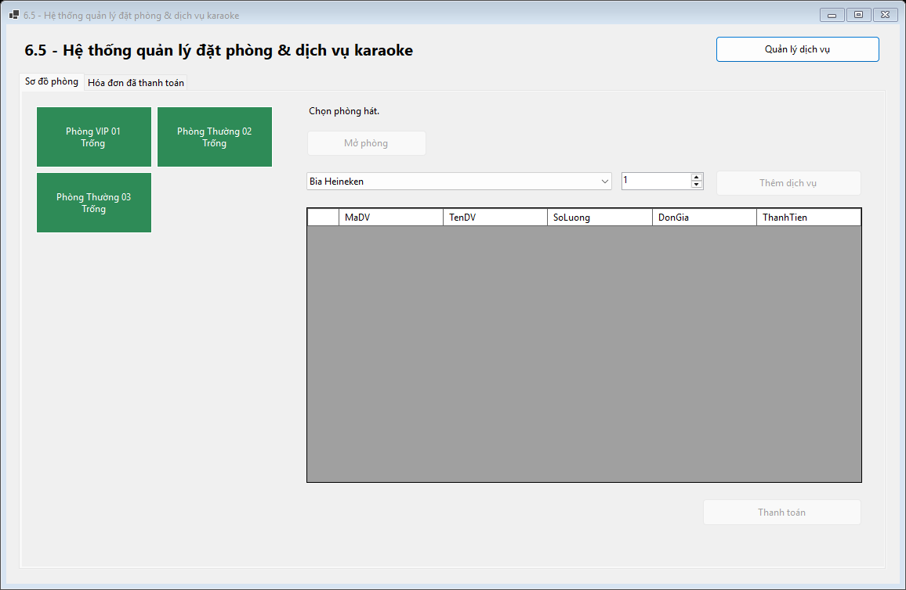
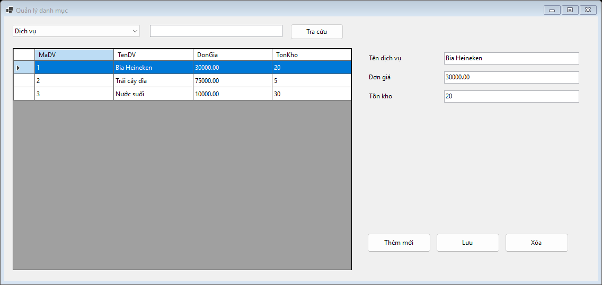
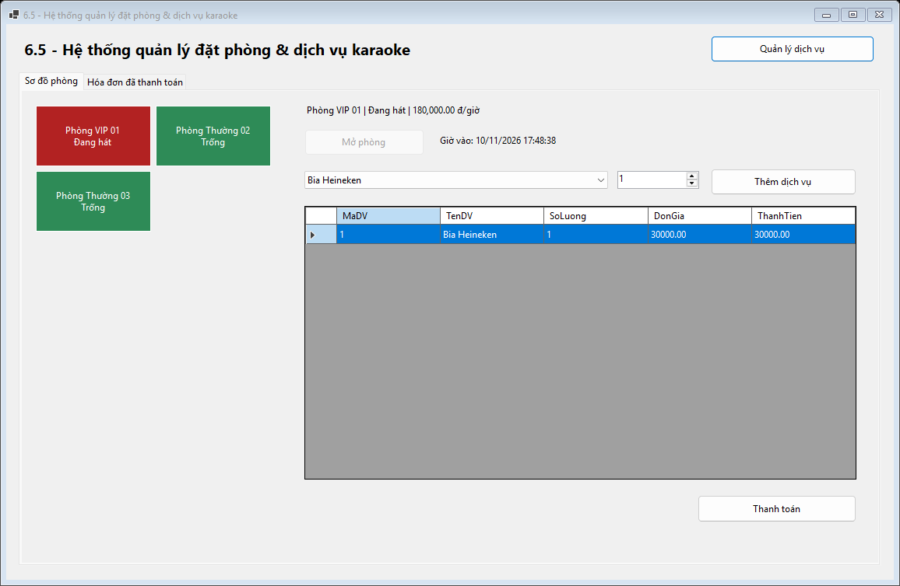
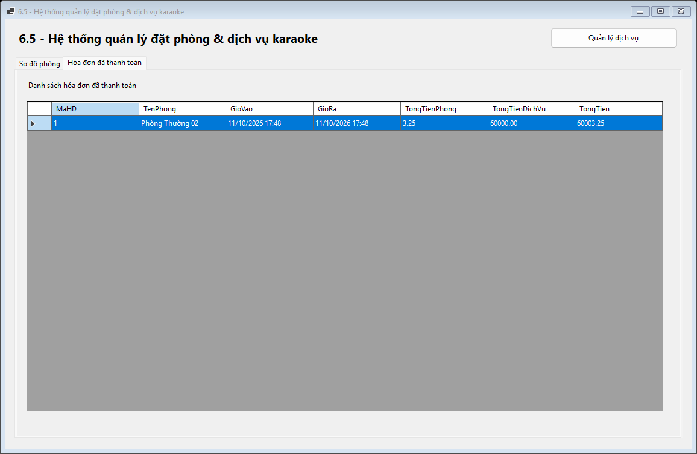
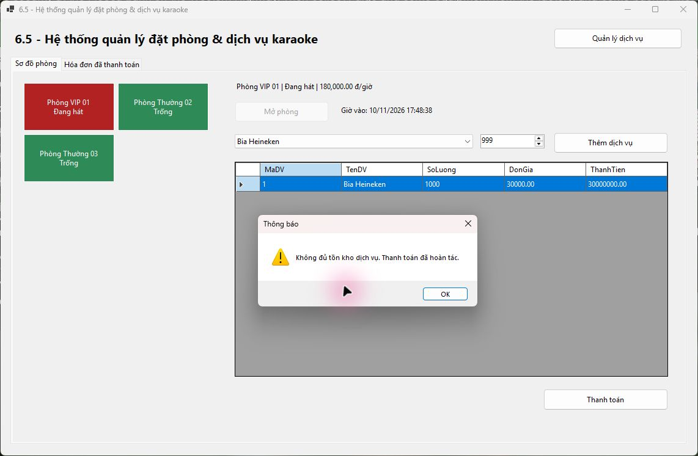

# Bài 6.5 - Hệ thống quản lý đặt phòng & dịch vụ karaoke

## Mục 1. Thông tin sinh viên

- Họ và tên sinh viên: Phạm Tuấn Thành
- Mã sinh viên: 24810320264
- Lớp / Khóa: D19QTANM1

### Quy tắc đã thống nhất

Tiền phòng tính theo thời gian hát thực tế và làm tròn đến 2 chữ số thập phân. Dịch vụ được trừ tồn khi thanh toán. Khi thiếu tồn, giao dịch hoàn tác toàn bộ và phòng vẫn Đang hát. Quản lý dịch vụ và danh sách hóa đơn đã thanh toán dùng cho các màn hình danh mục và báo cáo.

### Cách chạy

1. Chạy [Database/ScriptDB.sql](Database/ScriptDB.sql) trên SQL Server để tạo CSDL KaraokeDB và dữ liệu mẫu.
2. Mở [KaraokeManagement.sln](KaraokeManagement.sln) trong Visual Studio có workload .NET desktop development và SDK .NET 8.
3. Kiểm tra cấu hình trong [DatabaseHelper.cs](KaraokeManagement/DAL/DatabaseHelper.cs). Máy chủ mặc định là (localdb)\MSSQLLocalDB. Nếu dùng máy chủ khác, sửa chuỗi kết nối theo máy chủ đã chạy script.
4. Nhấn **F5**. Để mở Design View, chọn MainForm.cs hoặc CatalogForm.cs trong Solution Explorer và nhấn **Shift+F7**.

## Mục 2. Hình ảnh kết quả các màn hình chức năng

### 1. Sơ đồ phòng hát

### 2. Quản lý dịch vụ

### 3. Mở phòng và gọi dịch vụ

### 4. Hóa đơn đã thanh toán

### 5. Hoàn tác thanh toán khi thiếu tồn dịch vụ

